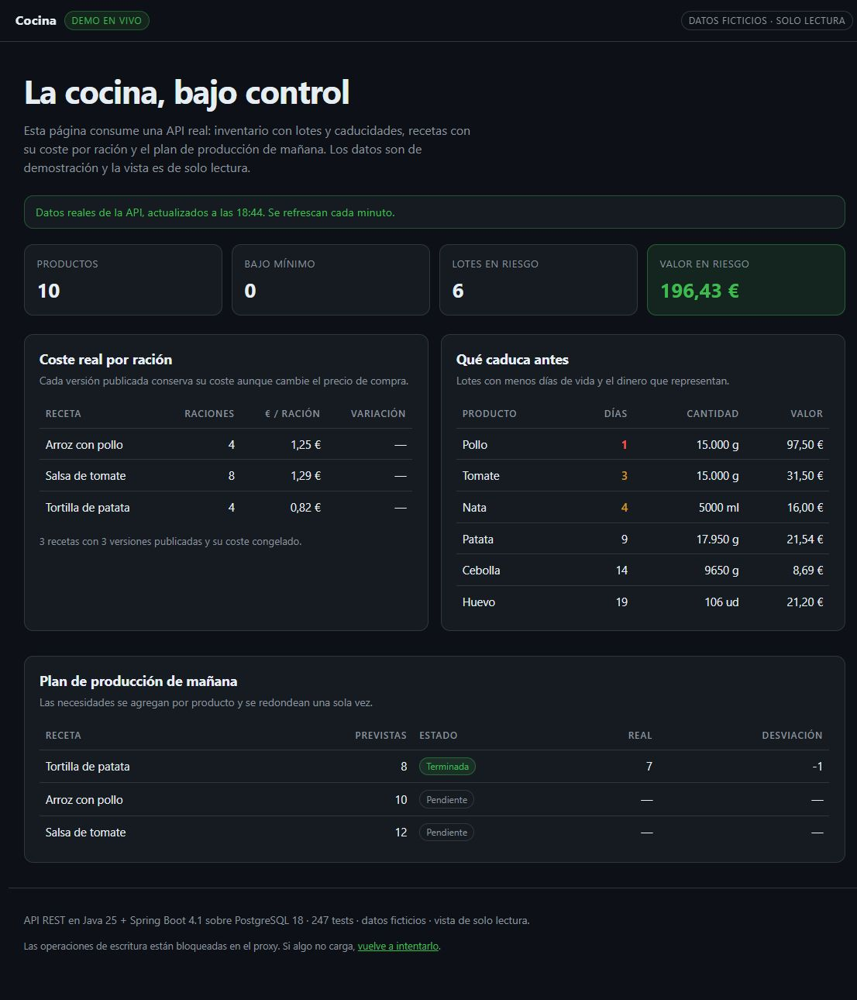

# Cocina — Sistema de gestión y control de cocina profesional

[](https://github.com/anevadog/cocina/actions/workflows/ci.yml)

**Una API para que la cocina de un restaurante funcione igual la lleve quien la lleve:** qué hay en el
almacén, cuánto cuesta de verdad cada plato y qué hay que producir hoy.



*Panel de demostración: los datos son ficticios, pero los sirve la API real.*

<!-- VIDEO: añadir aquí el enlace al vídeo de 2 minutos cuando esté grabado -->

## Qué resuelve

- **El coste de cada plato no se pierde.** Al publicar una receta se congela su coste por ración; si
  el proveedor sube el precio, la nueva versión lo refleja y la anterior queda como histórico.
- **Se sabe qué va a caducar y cuánto dinero supone**, antes de tirarlo. Un lote caducado no se puede
  usar en producción: la API lo bloquea.
- **El stock cuadra aunque trabajen varios a la vez.** Si dos cocineros producen al mismo tiempo, el
  almacén nunca queda en negativo ni se descuenta dos veces. Cada operación queda registrada con quién
  la hizo y cuándo.

## Cómo está hecho

| Pieza | Tecnología |
|---|---|
| Lenguaje y framework | Java 25 + Spring Boot 4 (API REST) |
| Base de datos | PostgreSQL 18 con migraciones Flyway |
| Seguridad | Login con JWT, contraseñas con Argon2id y cuatro roles (admin, jefe de cocina, cocinero, almacén) |
| Calidad | 247 tests automáticos; los de integración usan PostgreSQL real con Testcontainers |
| Entrega | Docker, GitHub Actions y despliegue en VPS con Caddy (HTTPS automático) |

El código está organizado en módulos (inventario, recetas, producción, calidad…) y un test de
arquitectura impide que un módulo se salte las fronteras de otro.

## Pruébalo

Requiere Docker en marcha, JDK 25 y una terminal `sh` (Git Bash, WSL o Linux):

```bash
git clone https://github.com/anevadog/cocina.git && cd cocina
sh scripts/demo.sh        # base aislada, datos de ejemplo y recorrido completo
```

Al terminar, Swagger UI queda en <http://localhost:8081/swagger-ui.html>. Usuario `demo.admin` y
contraseña `Demo2026!segura` (solo datos ficticios). Para pararlo: `sh scripts/demo.sh --stop`.
Detalle en [`docs/demo.md`](docs/demo.md).

## Para revisores técnicos

- [`docs/revision-tecnica.md`](docs/revision-tecnica.md): cada garantía con el test o la restricción
  de base de datos que la demuestra, y los límites conocidos.
- [`docs/decisiones.md`](docs/decisiones.md): decisiones técnicas (ADR) con alternativas y
  consecuencias.
- [`docs/arquitectura.md`](docs/arquitectura.md): módulos, modelo de datos y flujos críticos.

## Estado del proyecto

**Fases:** F7 cerrada (bloques A, B y C). La API arranca, aplica migraciones V1–V7 en PostgreSQL 18,
expone `/health`, `/ready` y OpenAPI, e incluye autenticación JWT con refresh rotatorio, RBAC por rol,
auditoría append-only protegida por trigger, inventario con lotes y PMP, recetas versionadas con coste,
producción con descuento atómico, temperaturas con alertas, mermas, incidencias, trazabilidad
lote → preparación, informes de costes y caducidades, seed de datos demo, copias de seguridad con
restauración probada, una medición de rendimiento repetible y una pila de producción con
`compose.prod.yaml` y Caddy. **247 tests** en verde más una comprobación de rendimiento opt-in. Queda
P2 (base legal y retención) antes de datos reales de empleados. Ver `docs/plan.md`.

## Documentación

| Documento | Contenido |
|---|---|
| `docs/requisitos.md` | Requisitos funcionales y no funcionales con criterios de aceptación |
| `docs/arquitectura.md` | Módulos, modelo de datos y flujos críticos |
| `docs/decisiones.md` | Registro de decisiones técnicas (ADR) |
| `docs/plan.md` | Fases, tareas y progreso |
| `docs/backups.md` | Copias de seguridad, restauración y prueba registrada |
| `docs/rendimiento.md` | Método y resultados de NFR-REN-01/02 |
| `docs/despliegue.md` | VPS, TLS, primer despliegue, actualización, backups y operación |
| `docs/seguridad.md` | Endurecimiento, gestión de secretos y datos personales |
| `docs/demo.md` | Guion y script de demostración reproducible con datos ficticios |
| `docs/demo-publica.md` | Demo pública de solo lectura para clientes y reclutadores: despliegue, seguridad y operación |
| `docs/revision-tecnica.md` | Guía para un revisor externo o auditor: qué mirar, cómo reproducirlo y qué límites hay |

## Requisitos del entorno

| Herramienta | Versión | Estado en la máquina de desarrollo |
|---|---|---|
| JDK (Temurin) | 25 LTS | Instalado |
| Docker Desktop + WSL2 | Docker 29.9.2, Compose v5.6.1, WSL 3.0.1.0 | Instalado y verificado |
| Git | cualquiera reciente | Instalado |
| Maven | no hace falta | Lo gestiona el wrapper (3.9.16) |

No se necesita instalar Maven ni PostgreSQL de forma nativa: Maven se resuelve con el wrapper y
PostgreSQL 18 corre en un contenedor.

> **Puerto:** el contenedor se publica en **5433** para no chocar con un PostgreSQL nativo que ya
> escuche en 5432. Se puede cambiar con `DB_PORT` en `.env`.

### Instalar Docker (Windows, PowerShell como administrador)

```powershell
wsl --install --no-distribution
winget install --id Docker.DockerDesktop -e --accept-package-agreements --accept-source-agreements
```

Reinicia si se solicita y verifica:

```bash
docker --version
docker compose version
```

## Puesta en marcha

```bash
cp .env.example .env          # opcional: valores locales; sin .env se usan los del compose
docker compose up -d          # PostgreSQL 18 en localhost:5433
./mvnw spring-boot:run        # API en http://localhost:8080 (aplica las migraciones al arrancar)
./mvnw spring-boot:run -Dspring-boot.run.profiles=local   # con logs DEBUG
```

- Health: `http://localhost:8080/health` (proceso, sin tocar la base de datos)
- Readiness: `http://localhost:8080/ready` (base de datos y migraciones; 503 si algo está caído)
- OpenAPI JSON: `http://localhost:8080/v3/api-docs`
- Swagger UI: `http://localhost:8080/swagger-ui.html`

Si el 5433 también estuviera ocupado, cambia `DB_PORT` en `.env` y vuelve a levantar el compose.

### Primer administrador y arranque seguro

- En el perfil `local` se crea `admin` con la contraseña de desarrollo `cambiar_en_local` (ver
  `application-local.yml`), solo si la tabla de usuarios está vacía.
- En cualquier otro perfil la API **no arranca** sin `JWT_SECRET` de al menos 32 bytes, y no crea
  ningún usuario salvo que definas `BOOTSTRAP_ADMIN_PASSWORD`. No hay credenciales por defecto.

```bash
# token de acceso
curl -s -X POST http://localhost:8080/api/v1/auth/login \
  -H 'Content-Type: application/json' \
  -d '{"username":"admin","password":"cambiar_en_local"}'

# uso del token
curl -s http://localhost:8080/api/v1/users -H "Authorization: Bearer <accessToken>"
```

### Datos de demostración

Con una base **vacía** (por ejemplo, tras `docker compose down -v`), el perfil `demo` crea usuarios,
catálogo, recetas publicadas, un plan de producción, temperaturas, una merma y una incidencia:

```bash
./mvnw spring-boot:run -Dspring-boot.run.profiles=local,demo
# o sobre el jar: java -jar target/cocina-0.1.0-SNAPSHOT.jar --spring.profiles.active=local,demo
```

- Usuarios: `demo.admin`, `demo.manager`, `demo.cook` y `demo.store`.
- Contraseña: `Demo2026!segura` por defecto; se cambia con `cocina.demo.password`
  (`COCINA_DEMO_PASSWORD` en el entorno) y nunca se escribe en el log.
- El seed es idempotente: si ya hay productos, no hace nada. No se ejecuta sin el perfil `demo`.
- Para enseñarlo sin preparar nada a mano: `sh scripts/demo.sh` arranca una base aparte, siembra y
  ejecuta el recorrido. Ver `docs/demo.md`.

## Despliegue en producción

La pila de producción es un VPS con `compose.prod.yaml`: PostgreSQL, la API y **Caddy** como proxy con
TLS automático. La base de datos no publica puertos y la API corre sin privilegios y con el sistema de
ficheros de solo lectura. Decisión y consecuencias en ADR-045; procedimiento completo en
`docs/despliegue.md`.

```bash
cp .env.production.example .env    # completar dominio, correo y secretos; chmod 600
docker compose -f compose.prod.yaml up -d --build
docker compose -f compose.prod.yaml ps
curl -fsS https://<dominio>/ready
```

- La documentación OpenAPI/Swagger está apagada en producción (`API_DOCS_ENABLED=false`).
- La copia diaria se programa con `cron` y se replica fuera del VPS con
  `scripts/backup-offsite.sh` (rclone). Ver `docs/despliegue.md` §8 y `docs/backups.md`.
- Antes de datos reales de empleados hay que cerrar **P2** (base legal y retención); ver
  `docs/seguridad.md`.

## Demo pública de solo lectura

Para enseñar el producto sin instalar nada y sin acceso de escritura hay una pila aparte,
`compose.demo.yaml`: PostgreSQL desechable, la API con perfiles `prod,demo` y Caddy sirviendo un panel
estático. El proxy solo permite `GET /api/v1/*` y el login del panel; cualquier otra llamada devuelve
403. Los datos son ficticios y `scripts/demo-public-reset.sh` los reinicia cuando se programe por cron.

```bash
cp .env.demo.example .env.demo     # dominio, correo y secretos; chmod 600
docker compose -f compose.demo.yaml --env-file .env.demo up -d --build
sh scripts/demo-public-reset.sh    # reiniciar los datos ficticios
```

Decisión en ADR-047 y procedimiento completo en `docs/demo-publica.md`. Mientras no esté desplegada,
`demo/recorrido/` ofrece un recorrido visual de seis escenas con una instantánea de la API real
(ADR-048, `docs/demo.md` §7). La demo **no** está desplegada
todavía: requiere VPS y dominio. Para previsualizarla en local está `demo/Caddyfile.local`.

## Comandos habituales

```bash
./mvnw verify            # compilar, tests (Testcontainers), formato, arquitectura y cobertura
./mvnw test              # solo tests — necesita Docker en marcha
./mvnw spotless:apply    # formatear el código (Spotless + palantir-java-format)
./mvnw spring-boot:run   # arrancar en local
./mvnw package           # generar el jar ejecutable en target/
./mvnw -Dtest=PerformanceBaselineCheck -Dcocina.performance=true test   # medición de rendimiento
sh scripts/backup.sh     # copia lógica en backups/ (Git Bash o WSL)
sh scripts/restore.sh backups/<archivo>.dump cocina_restore             # restaurar en base nueva
sh scripts/check-secrets.sh                                             # NFR-SEG-04 (también en CI)
sh scripts/demo.sh       # demostración reproducible con datos ficticios (deja Swagger en :8081)
sh scripts/demo.sh --stop                                               # parar y borrar la demo
sh scripts/demo-snapshot.sh                                             # regenerar los datos del recorrido visual
sh scripts/demo-public-reset.sh                                         # reiniciar los datos de la demo pública
docker compose ps        # estado de los contenedores
docker compose logs -f db
docker compose down      # parar PostgreSQL (añade -v para borrar los datos)
docker build -t cocina:local .   # imagen de la aplicación
```

En Windows con Git Bash, `./mvnw`; en CMD/PowerShell, `mvnw.cmd`.

El informe de cobertura queda en `target/site/jacoco/index.html`; `verify` no impone un umbral
(ADR-032). Si `spotless:check` falla, ejecuta `./mvnw spotless:apply` y revisa el diff.

## Estructura del repositorio

```text
cocina/
├─ README.md
├─ docs/                        # requisitos, arquitectura, decisiones, plan, memoria, backups, rendimiento, despliegue y seguridad
├─ scripts/                     # backup.sh, restore.sh, backup-offsite.sh y check-secrets.sh
├─ .mvn/wrapper/                # configuración del Maven Wrapper (Maven 3.9.16)
├─ .github/workflows/ci.yml     # check-secrets + ./mvnw verify en GitHub Actions
├─ mvnw  mvnw.cmd  pom.xml
├─ src/main/java/com/killa/cocina/
│  ├─ CocinaApplication.java
│  ├─ config/                   # reloj UTC, seguridad (JWT), propiedades, bootstrap del admin
│  ├─ demo/                     # seed de datos de ejemplo (perfil demo, PLA-05)
│  ├─ shared/
│  │  ├─ error/                 # cuerpo de error uniforme (PLA-02)
│  │  ├─ health/                # /health y /ready (PLA-04)
│  │  ├─ pagination/            # página independiente de Spring (PLA-03)
│  │  ├─ security/              # actor autenticado leído del token (PER-04)
│  │  └─ web/                   # requestId (NFR-OBS-01)
│  └─ modules/                  # auth, users, audit, inventory, suppliers, recipes, production, quality, reporting
├─ src/main/resources/
│  ├─ application.yml  application-local.yml  application-test.yml  application-prod.yml
│  └─ db/migration/
│     ├─ V1__baseline.sql             # establishments
│     ├─ V2__users_auth_audit.sql     # app_users, refresh_tokens, audit_logs
│     ├─ V3__inventory_catalog.sql    # categorías, productos, conversiones y proveedores
│     ├─ V4__inventory_movements.sql  # lotes, kardex inmutable y trigger
│     ├─ V5__recipes.sql              # recetas, versiones y composición congelada
│     ├─ V6__production.sql           # planes, ítems y batches
│     └─ V7__quality.sql              # temperaturas, mermas, incidencias y auditoría protegida
├─ src/test/java/com/killa/cocina/
│  ├─ architecture/             # ArchUnit: fronteras y permisos por endpoint
│  ├─ infrastructure/           # migraciones sobre PostgreSQL real
│  ├─ modules/                  # dominio puro e integración de auth, users e inventory
│  └─ support/                  # contenedor PostgreSQL compartido (Testcontainers)
├─ demo/                         # panel de la demo pública y recorrido visual estático (fuera del MVP)
├─ compose.yaml                 # PostgreSQL 18 para desarrollo (host: 5433)
├─ compose.prod.yaml            # pila de producción: PostgreSQL, API y Caddy
├─ compose.demo.yaml            # pila de demo pública de solo lectura (ADR-047)
├─ Caddyfile                    # TLS automático y cabeceras de seguridad
├─ Caddyfile.demo               # proxy de la demo: solo GET y login
├─ Dockerfile                   # imagen multi-stage, usuario no root, healthcheck
└─ .env.example  .env.production.example  .env.demo.example   # plantillas; los .env reales no se commitean
```

## Variables de entorno

Ver `.env.example` para desarrollo y `.env.production.example` para producción. Nunca se commitea
`.env` ni secretos reales; `scripts/check-secrets.sh` lo comprueba en CI.

## Convenciones

- Código en inglés; documentación y mensajes de API en español.
- Conventional Commits.
- Formato con Spotless (`./mvnw spotless:apply`); `verify` lo comprueba (ADR-032).
- Migraciones Flyway; `ddl-auto: validate`.
- Cantidades y dinero con `BigDecimal` (`numeric(12,3)` / `numeric(12,4)`).

## Licencia

PENDIENTE de decidir. No se distribuye todavía.
