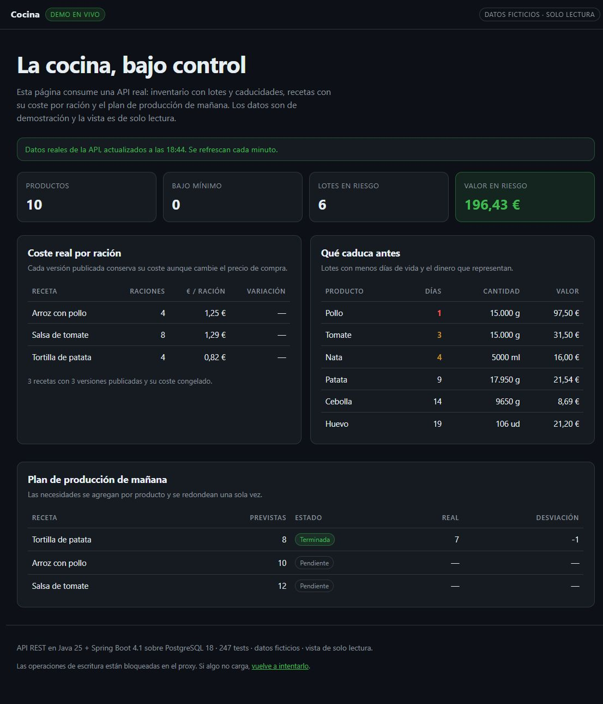

# Demo pública de solo lectura

> Material de demostración, **fuera del alcance del MVP** (ver ADR-047). Sirve para que un cliente o
> un reclutador abra una URL y vea el producto funcionando con datos reales de la API, sin instalar
> nada, sin credenciales y sin poder modificar nada.
>
> **Estado:** pila preparada y verificada en local (compose válido, proxy probado, panel renderizando
> datos y escrituras bloqueadas). **No está desplegada**: falta contratar el VPS y el dominio.

## 1. Qué es y qué no es

Es una pila Docker separada de producción:

- PostgreSQL 18 con base desechable, sembrada con el perfil `demo`.
- La misma API, con perfiles `prod,demo`: endurecimiento de producción y datos ficticios.
- Caddy sirviendo un panel estático y actuando de **cortafuegos de métodos**: solo deja pasar `GET`
  sobre `/api/v1/*` y el `POST /api/v1/auth/login` del panel.
- Un reinicio nocturno que borra la base y vuelve a sembrarla.

No es producción: no hay alta disponibilidad, no hay datos reales, no se puede escribir y no demuestra
la política de datos personales (**P2** sigue pendiente).

## 2. Qué ve el visitante



Una página con cuatro cifras (productos, bajo mínimo, lotes en riesgo y valor en riesgo), el coste por
ración de cada receta publicada, los lotes que caducan antes y el plan de producción de mañana con la
desviación real. Los datos se piden a la API cada minuto; la marca de tiempo del panel indica cuándo se
actualizaron por última vez.

## 3. Cómo funciona

```text
Navegador
   │  HTTPS
   ▼
Caddy (compose.demo.yaml)
   ├─ /                 → demo/site (HTML, CSS, JS estáticos)
   ├─ GET /api/v1/*     → API (solo lectura)
   ├─ POST /auth/login  → API (login del panel)
   └─ resto de /api/*   → 403 «Esta demostración es de solo lectura.»
                              │
                              ▼
                        API (prod,demo) ── PostgreSQL (volumen desechable)
```

| Archivo | Papel |
|---|---|
| `compose.demo.yaml` | Pila aislada (`name: cocina-demo`), volúmenes propios y límites de memoria |
| `Caddyfile.demo` | TLS, cabeceras, CSP y lista blanca de métodos |
| `demo/site/` | Panel estático: `index.html`, `style.css`, `app.js` |
| `.env.demo.example` | Plantilla de entorno; el archivo real es `.env.demo` y no se versiona |
| `scripts/demo-public-reset.sh` | Borra la base ficticia, vuelve a sembrar y espera a `/ready` |
| `demo/Caddyfile.local` | Previsualización en `http://localhost:8082` sin dominio ni TLS |

El panel inicia sesión con `demo.manager`. **La contraseña es pública a propósito**: el proxy impide
cualquier escritura, así que conocerla no da más capacidad que la de leer. Se cambia con
`COCINA_DEMO_PASSWORD` sin tocar el código.

## 4. Puesta en marcha

Requisitos: VPS con Docker Engine y Compose, dominio o subdominio con registro `A` al VPS, puertos
`80` y `443` abiertos. Referencia de preparación del host: `docs/despliegue.md` §2 y §3.

```bash
cd /srv/cocina
cp .env.demo.example .env.demo
chmod 600 .env.demo
# Editar: SITE_ADDRESS, ACME_EMAIL y los tres secretos.
openssl rand -base64 48     # JWT_SECRET
openssl rand -base64 24     # POSTGRES_PASSWORD
openssl rand -base64 24     # COCINA_DEMO_PASSWORD (opcional; por defecto la pública)

docker compose -f compose.demo.yaml --env-file .env.demo up -d --build
docker compose -f compose.demo.yaml --env-file .env.demo ps
curl -fsS https://<SITE_ADDRESS>/ready
```

Comprobación mínima después del despliegue:

```bash
curl -sS -o /dev/null -w "%{http_code}\n" https://<SITE_ADDRESS>/            # 200 panel
curl -sS -o /dev/null -w "%{http_code}\n" https://<SITE_ADDRESS>/api/v1/products  # 401 sin token
curl -sS -o /dev/null -w "%{http_code}\n" -X POST https://<SITE_ADDRESS>/api/v1/products  # 403
```

**No ejecutar esta pila en el mismo VPS que `compose.prod.yaml`**: ambas publican `80` y `443`. Si se
quiere demo y producción a la vez, hacerlo en dos servidores o con dos direcciones y un proxy delante.

## 5. Seguridad

| Medida | Dónde | Efecto |
|---|---|---|
| Solo `GET` de `/api/v1/*` | `Caddyfile.demo` | Ninguna escritura llega a la API, aunque el token la permita |
| Solo `POST /auth/login` | `Caddyfile.demo` | No hay refresh, logout ni recuperación de contraseña expuestos |
| Resto de `/api/*` → 403 | `Caddyfile.demo` | Error explícito, no un 404 engañoso |
| Cuerpo máximo de 64 KB | `Caddyfile.demo` | El panel solo envía un login pequeño |
| CSP sin recursos externos | `Caddyfile.demo` | Solo scripts, estilos y `fetch` del propio dominio |
| HSTS, `nosniff`, `DENY`, `no-referrer` | `Caddyfile.demo` | Cabeceras de endurecimiento |
| Base sin puertos publicados | `compose.demo.yaml` | Solo accesible desde la red interna |
| API sin privilegios y rootfs de solo lectura | `compose.demo.yaml` | `cap_drop: ALL`, `no-new-privileges`, `tmpfs /tmp` |
| Documentación apagada | `.env.demo` | `API_DOCS_ENABLED=false`; el panel no la necesita |
| Secretos fuera del repositorio | `.env.demo` + `chmod 600` | `.gitignore` excluye `.env.*`; `check-secrets.sh` en CI |

Lo que **no** incluye y conviene añadir si la demo crece: límite de peticiones (Caddy no lo trae de
serie; `fail2ban` sobre los logs o un proxy/CDN delante), alertas de disponibilidad y un aviso legal
con política de privacidad si se publica con dominio propio (PENDIENTE: el titular debe revisarlo; la
página no usa cookies ni analítica de terceros).

El bloqueo de cuenta por 5 intentos fallidos (423 durante 15 minutos) también aplica a la demo: si
alguien se equivoca a propósito con `demo.manager`, el panel deja de cargar hasta el reinicio nocturno
o hasta reiniciar la pila. El reinicio programado lo resuelve sin intervención.

## 6. Operación

Reinicio nocturno (recomendado, 04:00 UTC):

```bash
# crontab del usuario de despliegue (debe poder usar docker)
0 4 * * * cd /srv/cocina && sh scripts/demo-public-reset.sh >> /var/log/cocina-demo-reset.log 2>&1
```

El script para la API, elimina el contenedor y el volumen `cocina-demo-db-data`, levanta la pila otra
vez y espera hasta 120 s a que `/ready` responda. No toca la base de desarrollo ni la de producción.

| Tarea | Comando |
|---|---|
| Ver estado | `docker compose -f compose.demo.yaml --env-file .env.demo ps` |
| Logs del proxy | `docker compose -f compose.demo.yaml --env-file .env.demo logs -f proxy` |
| Logs de la API | `docker compose -f compose.demo.yaml --env-file .env.demo logs -f api` |
| Reiniciar datos | `sh scripts/demo-public-reset.sh` |
| Actualizar tras un cambio | `git pull && docker compose -f compose.demo.yaml --env-file .env.demo up -d --build` |
| Parar sin borrar | `docker compose -f compose.demo.yaml --env-file .env.demo down` |

El panel se refresca solo cada minuto; si la API está reiniciando, muestra el error y el botón
«vuelve a intentarlo» recupera la carga sin recargar la página.

## 7. Coste y recursos

Con la referencia de `docs/despliegue.md` §2 (precios orientativos, confirmar con el proveedor):

| Elemento | Coste aproximado |
|---|---|
| VPS 2 vCPU / 4 GB (build en el propio servidor) | 5–12 €/mes según proveedor; la referencia de `docs/despliegue.md` para 2 GB es 4–6 €/mes |
| Dominio o subdominio | ~10 €/año |
| Certificado TLS (Let's Encrypt) | 0 € |
| Total | **≤ 15 €/mes** |

Límites de la pila: PostgreSQL 512 MB, API 768 MB y Caddy sin límite explícito. Con 2 GB de RAM se
puede ejecutar, pero compilar en el servidor necesita margen; 4 GB evitan el OOM durante el build.

## 8. Límites de la demo

El panel consume cinco endpoints reales; el resto está cerrado por el proxy y la API exige JWT. La
prueba técnica está en `docs/revision-tecnica.md`.

La demo **no** demuestra que el sistema aguante producción real, que los datos sean de un cliente, que
exista interfaz de usuario para operar (el panel es de solo lectura) ni que P2 esté resuelto.

## 9. Previsualización local

Con la demo de `scripts/demo.sh` levantada en `:8081`:

```bash
docker run --rm -d --name cocina-demo-preview \
  -p 8082:8082 \
  -v "$PWD/demo/Caddyfile.local:/etc/caddy/Caddyfile:ro" \
  -v "$PWD/demo/site:/srv:ro" \
  caddy:2-alpine
```

Abrir <http://localhost:8082>. En Linux, añadir `--add-host host.docker.internal:host-gateway`.
Para parar: `docker rm -f cocina-demo-preview`.

La previsualización usa HTTP y no obtiene certificado; reproduce la misma lista blanca de métodos que
la pila real, así que sirve para comprobar que el panel no necesita escrituras.

## 10. Problemas y soluciones

| Síntoma | Causa probable | Solución |
|---|---|---|
| El panel dice «No se pudo iniciar la sesión» | Contraseña cambiada o usuario bloqueado | Revisar `COCINA_DEMO_PASSWORD`; reiniciar la demo |
| El panel carga pero las tablas están vacías | La API arrancó sin perfil `demo` | Comprobar `SPRING_PROFILES_ACTIVE=prod,demo` y los logs del seed |
| `502` en `/api/v1/*` | La API no está sana | `docker compose ... ps` y `logs api`; esperar a `/ready` |
| Caddy no obtiene certificado | DNS sin propagar o `80`/`443` cerrados | `dig +short <dominio>`; revisar firewall y logs de Caddy |
| `403` al probar un `POST` | Es el comportamiento esperado | La demo es de solo lectura |
| Datos raros tras una prueba | Alguien encontró un estado no previsto | `sh scripts/demo-public-reset.sh` |

## 11. Pendientes

- **Despliegue real**: requiere VPS y dominio; no se ha hecho desde el repositorio.
- **Aviso legal y privacidad**: contenido PENDIENTE de revisión por el titular si se publica.
- **Límite de peticiones**: no incluido; valorar `fail2ban` o un CDN/proxy delante.
- **Swagger público**: no se expone. Si un revisor técnico lo pide, habilitarlo solo con autenticación
  básica en Caddy y `API_DOCS_ENABLED=true` en una copia, nunca en la demo abierta.
- **P2**: fuera del alcance de la demo; no introducir datos reales de empleados.
