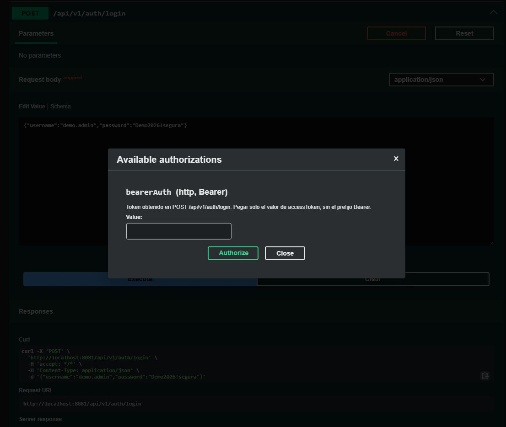
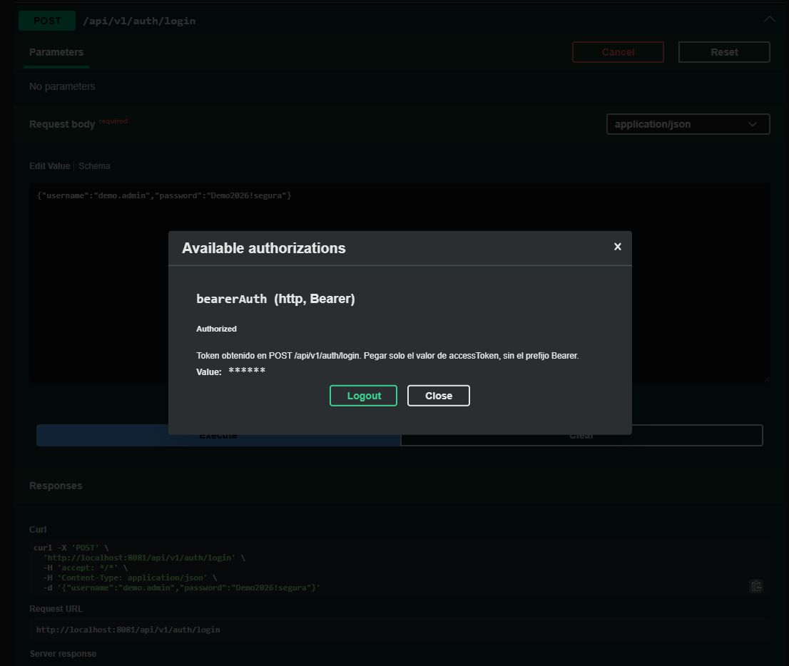
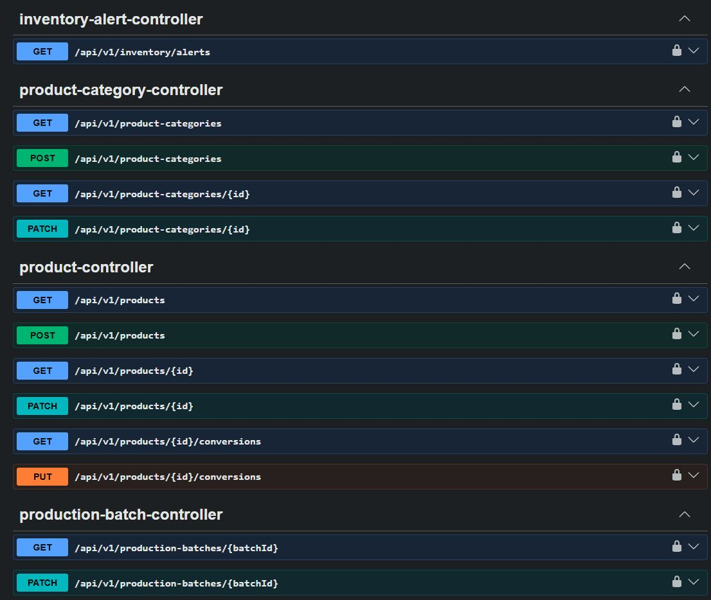
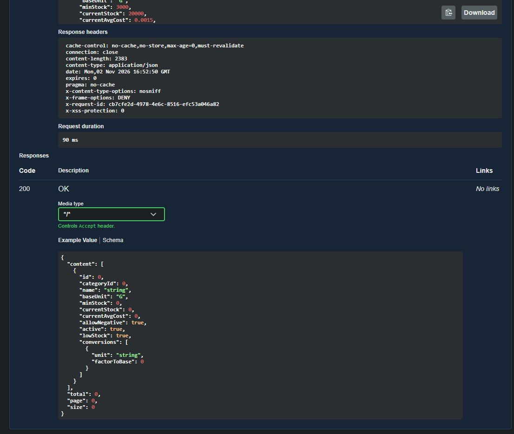

# Guía de revisión técnica

> Para un revisor externo o un auditor que no conoce el proyecto: qué mirar, en qué orden, cómo
> reproducirlo y qué límites tiene. No sustituye a `docs/memoria.md`; lo ordena para una revisión.
> Última revisión: 2026-11-02.

## 1. Qué se está revisando

Una API REST para la operación interna de la cocina de un restaurante: inventario con lotes y
caducidades, recetario versionado con coste congelado, producción con descuento de stock, permisos por
puesto y trazabilidad.

Tres cosas que conviene saber antes de empezar:

- **No hay frontend.** El producto del MVP es el contrato HTTP; Swagger UI es documentación, no la
  aplicación. Un revisor no encontrará pantallas de negocio.
- **Un solo establecimiento activo**, pero el modelo lleva `establishment_id` desde la primera
  migración.
- **Repositorio privado en GitHub**: `origin` → <https://github.com/anevadog/cocina>. Para revisarlo hay
  que pedir acceso o clonarlo con una cuenta autorizada; el CI de GitHub Actions se ejecuta en cada
  push a `main`.

## 2. Revisión en cuatro pasos

| Paso | Comando | Qué debe verse |
|---|---|---|
| 1. Historia y estado | `git log --oneline` y `git status` | Un commit por fase o bloque, mensajes convencionales y árbol limpio |
| 2. Verificación completa | `.\mvnw.cmd -B verify` (Windows) o `./mvnw -B verify` | `BUILD SUCCESS`, **247 tests**, 0 fallos |
| 3. Secretos | `sh scripts/check-secrets.sh` | `OK: no se han encontrado secretos versionados.` |
| 4. Recorrido real | `sh scripts/demo.sh` | Nueve pasos contra PostgreSQL 18 y la API; al final deja Swagger en `:8081` |

Notas de ejecución:

- `verify` necesita **Docker** en marcha: los tests de integración levantan `postgres:18` con
  Testcontainers y aplican las migraciones V1–V7. Tarda varios minutos.
- Los scripts se ejecutan con **Git Bash o WSL**, no con PowerShell.
- La demo usa una base desechable aparte (`cocina_demo`, puerto 55432). No toca la base de desarrollo
  (`cocina`, puerto 5433). `sh scripts/demo.sh --stop` la para y la borra.
- `verify` comprueba también el formato (Spotless) y genera el informe de cobertura en
  `target/site/jacoco`; la cobertura es informativa, sin umbral (ADR-032).

## 3. Dónde está la prueba de cada garantía

La tabla evita tener que confiar en la documentación: cada regla de negocio tiene un test con nombre
propio o una restricción en la base de datos.

| Garantía | Dónde se comprueba |
|---|---|
| El kardex es inmutable (ni API ni SQL) | Trigger de V4 + `StockMovementsIntegrationTest.elKardexEsInmutable` |
| Nunca hay stock negativo con la política de bloqueo | `elAjusteNoDejaSaldoNegativo`, `dosSalidasSimultaneasNoCruzanElCero` |
| Compras y ajustes recalculan el PMP correctamente | `lasComprasRecalcularElPmp`, `lasComprasSimultaneasCalculanBienElPmp` |
| Movimientos simultáneos no pierden actualizaciones (NFR-INT-01) | `StockConcurrencyIntegrationTest` |
| Una versión publicada es inmutable y su coste no cambia con el PMP | Triggers de V5 + `RecipePublishingIntegrationTest.elTriggerProtegeLaVersionPublicada`, `elCosteCongeladoNoCambiaConElPmp` |
| La producción descuenta de forma atómica y no sobrescribe | `terminaLaProduccionConDescuentoAtomico`, `elFalloParcialNoDejaRastro` |
| Un lote caducado no se consume | `ProductionExecutionIntegrationTest.losLotesCaducadosNoSeConsumen` |
| Producciones simultáneas no sobrevenden | `laConcurrenciaNoSobrevende` (bloqueo ordenado, ADR-037) |
| Cada endpoint declara permiso y los permisos existen | `EndpointAuthorizationTest` (ArchUnit sobre anotaciones) |
| Los roles no pueden hacer de más | `UsersAuthorizationIntegrationTest`, `RoleMatrixTest` |
| El dominio no depende de Spring ni de JPA; los módulos no se saltan sus fronteras | `ModuleBoundariesTest` (ArchUnit) |
| Las migraciones aplican sobre PostgreSQL real | `SchemaMigrationTest`, `aplicaLaMigracionBaseline` |
| Los informes de costes y caducidades se calculan y respetan permisos | `ReportingIntegrationTest`, `RecipeCostReportTest`, `ExpiryRiskReportTest` |
| El contrato OpenAPI declara el token | `OpenApiConfigTest` |
| Errores uniformes y `requestId` | `GlobalExceptionHandlerTest`, `RequestIdFilterTest` |
| `/ready` refleja base de datos y migraciones | `ReadinessIntegrationTest` |

## 4. Evidencia visual del contrato

Capturas tomadas el 2026-11-02 contra la demo real (`cocina_demo`), con datos ficticios. No contienen
tokens: donde aparece la autorización, el valor está oculto.

El contrato declara `bearerAuth (http, Bearer)` y explica de dónde sale el token. Antes de este
cambio, Swagger no mostraba el botón **Authorize** y los endpoints protegidos no se podían probar
desde la interfaz.

Tras pegar el `accessToken`, el diálogo pasa a **Authorized** y el valor queda enmascarado.

Los endpoints de negocio llevan candado; `auth`, `/health`, `/ready` y la documentación, no. Es la
representación visual de la misma regla que verifica `EndpointAuthorizationTest`.

`GET /api/v1/products` autenticado: **200**, cabeceras de seguridad y duración de la petición. La
respuesta real trae los 10 productos del seed.

**Qué no demuestran estas capturas:** no son una prueba de seguridad. Demuestran que el contrato
declara la autenticación y que la interfaz la aplica. La prueba de que el servidor la exige está en
los tests de autorización y en la configuración de Spring Security.

## 5. Decisiones que un revisor suele cuestionar

| Pregunta | Respuesta corta | Dónde |
|---|---|---|
| ¿Por qué un monolito modular? | Un despliegue, fronteras verificadas con ArchUnit; sin mensajería ni caché en el MVP | ADR-007, `ModuleBoundariesTest` |
| ¿Cómo se evita que un módulo use las entidades de otro? | El dominio no importa Spring ni JPA y no accede a infraestructura ajena; lo verifica ArchUnit | `docs/arquitectura.md` §2, `ModuleBoundariesTest` |
| ¿Por qué el coste no se recalcula al cambiar el PMP? | El coste se congela al publicar la versión; el histórico no se reescribe | ADR-034/035, `RecipePublishingIntegrationTest` |
| ¿Cómo se evita sobrevender con dos cocineros a la vez? | Bloqueo ordenado de productos y descuento en una transacción | ADR-022 y ADR-037, `laConcurrenciaNoSobrevende` |
| ¿Se guardan secretos en el repositorio? | No; `.env*` ignorado, `check-secrets.sh` en CI y en local, y `prod` no arranca sin `JWT_SECRET` | `docs/seguridad.md` §4 |
| ¿Qué pasa con los datos personales? | Se minimizan y se documentan; la base legal y la retención **no están decididas** (P2) | `docs/seguridad.md` §6 |
| ¿Hay alta disponibilidad? | No: un VPS con Docker Compose y Caddy. Es una decisión consciente para el MVP | ADR-045, `docs/despliegue.md` §10 |
| ¿La cobertura tiene umbral? | No; JaCoCo se publica como informe (P5) | ADR-032 |

## 6. Límites conocidos

- **P2 pendiente:** política de retención y base legal RGPD/LOPDGDD. Bloquea el uso con datos reales de
  empleados; el establecimiento lo resolverá con su asesoría. Lista de comprobación en
  `docs/seguridad.md` §6.5.
- **Sin frontend, TPV, facturación, fichaje ni pedidos a proveedores.** Fuera de alcance por decisión,
  no por olvido: ver `docs/requisitos.md`.
- **Un solo establecimiento activo.** El modelo está preparado, pero no hay gestión multi-sede.
- **Cobertura informativa y sin análisis estático adicional** (Error Prone/NullAway evaluados y no
  adoptados todavía).
- **Rendimiento medido con un check opt-in**, no en CI: peor p95 de lectura 93 ms (umbral 300 ms) y
  necesidades de 500 raciones en 136 ms (umbral 2 000 ms). Método y límites en `docs/rendimiento.md`.
- **Copias:** prueba de restauración registrada el 2026-11-02 sobre un volcado de 98 KB; no se ha
  probado una restauración a gran escala.

## 7. Qué no está en el repositorio

- Secretos, contraseñas reales ni datos personales.
- Volcados de base de datos (`backups/` está ignorado).
- Artefactos de build (`target/`).
- Credenciales de la demo fuera de la documentación: son ficticias y solo existen con el perfil
  `demo`.

## 8. Si solo hay diez minutos

1. `git log --oneline` — la historia cuenta las fases sin leer nada más.
2. Abrir `docs/arquitectura.md` §2 (módulos), §3 (modelo de datos) y §7 (API).
3. Abrir esta guía, sección 3, y elegir dos garantías: buscar su test y leerlo.
4. `sh scripts/demo.sh` — ver la API responder de verdad y terminar en Swagger autenticado.

Si algo de lo anterior no cuadra, es un hallazgo: anótalo con el comando ejecutado y la salida.
